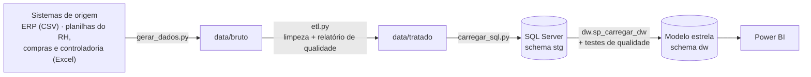
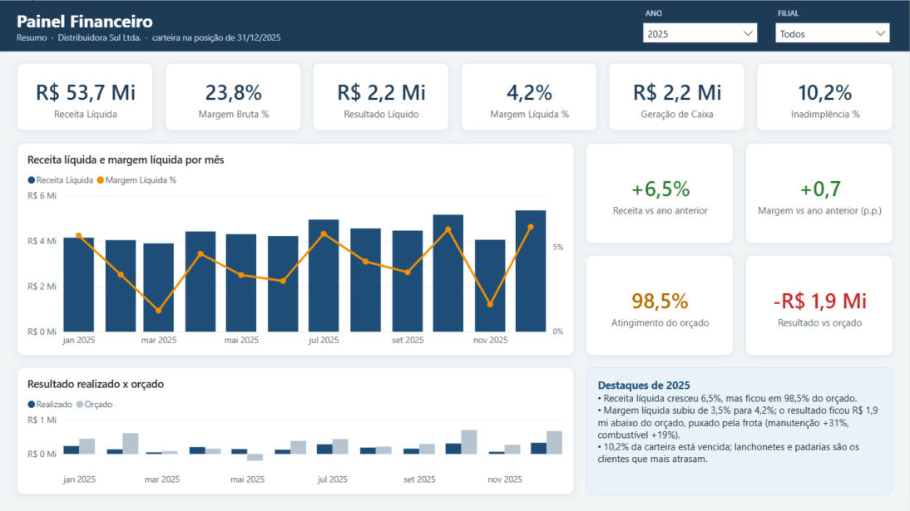

# Distribuidora Sul: base de dados integrada para BI

Uma empresa fictícia com dois anos de operação (2024–2025). Os dados de vendas, financeiro, compras, estoque e RH saem "sujos" dos sistemas de origem. Aqui eles são tratados com Python e organizados num modelo estrela no SQL Server, prontos para o Power BI.

Este é o **projeto 0** do meu portfólio: a fundação que alimenta os painéis de financeiro, RH, compras e automação.

> Todos os dados são **fictícios e gerados por código**. Empresas, pessoas e CNPJs não existem (os CNPJs têm dígitos verificadores válidos só para o teste de validação).

## O que este projeto mostra

| Competência | Onde está |
|---|---|
| **Python (pandas)**: ETL e qualidade de dados | [`python/etl.py`](python/etl.py) trata 11 tipos de problema e gera um [relatório de qualidade](docs/relatorio_qualidade.md) a cada execução |
| **SQL Server**: modelagem e carga | [`sql/`](sql/): staging, modelo estrela, procedure de carga com transação, testes automáticos e views com CTE e funções de janela |
| **Power BI e DAX** | [Painel Financeiro](docs/painel_financeiro.md) em formato PBIP (modelo em TMDL, relatório em PBIR): relacionamentos inativos (`USERELATIONSHIP`), inteligência de tempo e medidas conferidas contra o SQL |
| **Modelagem dimensional** | 8 dimensões e 9 fatos com grão definido ([dicionário de dados](docs/dicionario_de_dados.md)) |
| **Processos administrativos** | Contas a pagar e a receber, DRE por competência, orçamento, folha, ponto, estoque e compras |

## A empresa

**Distribuidora Sul Ltda.** distribui alimentos, bebidas, limpeza e higiene para supermercados, mercados, restaurantes, padarias e hotéis do RS. A matriz e o centro de distribuição ficam em Porto Alegre, e há filiais em Caxias do Sul e Pelotas.

| | |
|---|---|
| Receita (2 anos) | R$ 121 milhões |
| Resultado | 3,0% da receita em 2024 → 3,6% em 2025 |
| Notas fiscais | 23 mil (95 mil itens) |
| Clientes / produtos / fornecedores | 420 / 90 / 40 |
| Funcionários | cerca de 95 ativos (171 no histórico, com rotatividade) |

A simulação tem comportamento de negócio de propósito: sazonalidade por categoria, um evento que derruba as vendas de uma filial, clientes que atrasam e viram inadimplentes, fornecedores impontuais que causam ruptura de estoque, orçamento com vieses e rotatividade concentrada em cargos operacionais. Os painéis do portfólio vão investigar esses padrões.

## Fluxo dos dados



## Problemas de qualidade encontrados e tratados

| Fonte | Problema | Tratamento |
|---|---|---|
| Vendas (ERP) | 286 linhas exportadas em duplicidade | Removidas |
| Vendas (ERP) | Código de produto com espaço ou minúscula | Padronizado |
| Vendas (ERP) | Preço 100 vezes maior (vírgula esquecida) | Detectado pela mediana do produto no mês e corrigido |
| Clientes (ERP) | Mesmo CNPJ com dois códigos | Unificado + tabela de-para aplicada em vendas e títulos |
| Clientes (ERP) | Cidade escrita de várias formas ("POA", "Sao Leopoldo") | Padronizada |
| Contas a pagar | Datas em dois formatos na mesma coluna; valores como texto "R$ 1.234,56" | Convertidos |
| Contas a pagar | Centro de custo em branco | Inferido pela descrição ou pela conta contábil |
| Contas a receber | Baixa com ano digitado errado (pago antes de emitir) | Corrigido quando a regra permite |
| Orçamento (Excel) | Formato largo com linhas de título | Transformado em linhas (unpivot) |
| Funcionários (Excel) | Setor com grafias diferentes; salário como texto | Ligado ao centro de custo; convertido |
| Ponto (24 CSVs) | Layout mudou em mar/2025; horas extras em "hh:mm" | Consolidado e convertido para horas decimais |

Os números de cada execução ficam em [`docs/relatorio_qualidade.md`](docs/relatorio_qualidade.md).

## Modelo estrela

| Fato | Grão (uma linha por...) | Usado em |
|---|---|---|
| `fato_venda` | item de nota fiscal | Comercial, margem, curva ABC |
| `fato_conta_receber` | título (parcela) | Inadimplência, aging, prazo médio de recebimento |
| `fato_conta_pagar` | título | Fluxo de caixa, custos por centro de custo |
| `fato_dre` | mês × conta × centro de custo × filial | DRE gerencial |
| `fato_orcamento` | mês × conta × centro de custo | Orçado × realizado |
| `fato_compra` | item de pedido de compra | Pontualidade de fornecedores |
| `fato_estoque_movimento` | movimento de estoque | Posição, giro e cobertura |
| `fato_ponto` | funcionário × mês | Absenteísmo e horas extras |
| `fato_quadro_mensal` | funcionário × mês | Headcount e rotatividade |

Dimensões: calendário (com feriados e dias úteis), filial, centro de custo, conta (com ordem e sinal da DRE), produto, cliente, fornecedor e funcionário.

Depois de cada carga, `dw.sp_testes_qualidade` confere 11 regras. Exemplos: nenhuma linha se perde entre o staging e o modelo, o valor de cada nota bate com os títulos a receber, a receita da DRE bate com as vendas, nenhum produto fica com estoque negativo.

## Como rodar

Requisitos: Python 3.12 e, para a etapa SQL, o SQL Server Express (gratuito) com autenticação do Windows.

```bash
python -m venv .venv
.venv\Scripts\activate
pip install -r requirements.txt

python python/gerar_dados.py     # opcional: os dados já estão no repositório
python python/etl.py             # data/bruto -> data/tratado + relatório de qualidade
python python/carregar_sql.py    # cria o banco, carrega e roda os testes (~20 s)
```

O servidor padrão é `localhost\SQLEXPRESS`. Para outro servidor, use `--servidor "NOME"`.

> Em Windows em português, o instalador em inglês do SQL Server Express falha com "The English-language version of SQL Server is not supported by this SQL Server media". Baixe a mídia em português pelo próprio instalador (`/ACTION=Download /LANGUAGE=pt-BR /MEDIATYPE=Core`) e extraia numa pasta de caminho curto.

## Estrutura

```
data/bruto/       arquivos como saem dos sistemas (ERP, RH, compras, financeiro)
data/tratado/     arquivos limpos e padronizados (entrada do SQL e do Power BI)
docs/             dicionário de dados e relatório de qualidade
python/           geração dos dados, ETL e carga no SQL Server
sql/              scripts numerados na ordem de execução
powerbi/          painéis em formato PBIP (modelo semântico em TMDL + relatório) e tema de cores
```

## Painéis sobre esta base

1. **Financeiro**: DRE, orçado × realizado, contas a receber e fluxo de caixa, em 4 páginas. O modelo tem 60 medidas DAX ([`Medidas.tmdl`](powerbi/Financeiro.SemanticModel/definition/tables/Medidas.tmdl)), e todas as de cálculo foram conferidas contra o SQL. O [roteiro do painel](docs/painel_financeiro.md) traz as páginas, as decisões de modelagem e os números de conferência.

   

2. **People Analytics**: rotatividade, absenteísmo e custo de pessoal
3. **Compras e estoque**: curva ABC, ruptura e pontualidade de fornecedores
4. **Excel + automação**: consolidação com Power Query e conciliação

---

Lucas Gama · Analista de Dados & BI · [LinkedIn](https://www.linkedin.com/in/lucasvianagama)
