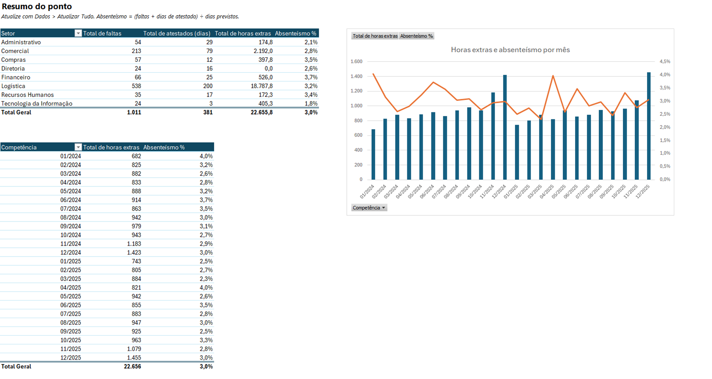
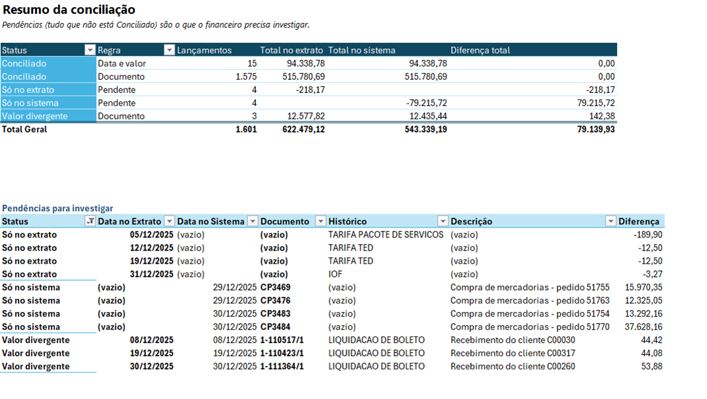

# Excel + automação: roteiro

Projeto 4 do portfólio: duas rotinas administrativas que viram um clique em **Dados > Atualizar Tudo**, feitas só com Excel e Power Query (sem macro, sem instalar nada). As pastas de trabalho estão em [`excel/`](../excel), e o código M de cada consulta está versionado em [`excel/consultas/`](../excel/consultas), legível direto no GitHub.

## 1. Consolidação do ponto mensal (RH)

[`excel/Consolidacao_Ponto.xlsx`](../excel/Consolidacao_Ponto.xlsx)

**Antes.** Todo mês o RH recebe um arquivo de ponto: são 24 em 2024 e 2025. Em março de 2025 o modelo da planilha mudou: colunas com outros nomes e em outra ordem, e as horas extras vêm como texto "hh:mm". Fechar absenteísmo e horas extras era abrir arquivo por arquivo, copiar, colar, arrumar colunas e converter horas.

**Depois.** A consulta [`Ponto Consolidado`](../excel/consultas/Ponto%20Consolidado.pq):

- lê a pasta inteira (`Folder.Files`), então o arquivo do mês seguinte entra sozinho;
- tira a competência do nome do arquivo (`ponto_2025_03.csv` → 01/03/2025);
- traz o layout novo para os nomes do layout antigo (`Table.RenameColumns` com `MissingField.Ignore`);
- converte "12:30" em 12,5 horas e calcula os dias previstos.

A aba **Resumo** tem duas tabelas dinâmicas (por setor e por mês, com absenteísmo como campo calculado) e um gráfico de horas extras × absenteísmo.

**Conferência:** 2.244 registros, 1.011 faltas, 381 dias de atestado e 22.655,75 horas extras, os mesmos números da tabela `dw.fato_ponto` no SQL Server.

## 2. Conciliação bancária (financeiro)

[`excel/Conciliacao_Bancaria.xlsx`](../excel/Conciliacao_Bancaria.xlsx)

**Antes.** No fechamento, o financeiro compara o extrato do banco com os títulos baixados no sistema, linha a linha. Em dezembro/2025 são cerca de 1.600 lançamentos.

**Depois.** Três consultas:

| Consulta | O que faz |
|---|---|
| [`Extrato Bancário`](../excel/consultas/Extrato%20Banc%C3%A1rio.pq) | Lê o CSV do banco (ponto e vírgula, vírgula decimal, Windows-1252) |
| [`Títulos no Sistema`](../excel/consultas/T%C3%ADtulos%20no%20Sistema.pq) | Junta recebimentos e pagamentos do período; pagamentos entram negativos, como no banco |
| [`Conciliação`](../excel/consultas/Concilia%C3%A7%C3%A3o.pq) | Casa os dois em duas passadas: **documento** primeiro e, no que sobrou, **data + valor** (PIX sem identificação) |

O que não casa vira pendência, e a aba Resumo lista só as pendências para investigar:

| Status | Lançamentos | O que é |
|---|---:|---|
| Conciliado (documento) | 1.575 | Título ou pagamento identificado e com o mesmo valor |
| Conciliado (data e valor) | 15 | PIX recebidos sem identificação |
| Valor divergente | 3 | Clientes que pagaram juros não lançados (R$ 142,38) |
| Só no extrato | 4 | Tarifas e IOF debitados pelo banco e não lançados (R$ 218,17) |
| Só no sistema | 4 | Pagamentos de 29 e 30/12 que só compensaram em janeiro (R$ 79.215,72) |

O extrato de dezembro é gerado por [`python/gerar_extrato.py`](../python/gerar_extrato.py) a partir dos títulos, com essas diferenças colocadas de propósito. A conciliação encontrou exatamente as 11 pendências.

## Detalhes que fazem funcionar em qualquer computador

- **Caminho relativo.** A pasta de dados é calculada a partir de onde o Excel está salvo (`CELL("filename")` na aba Configuração) e lida pelo Power Query com `Excel.CurrentWorkbook()`. Basta clonar o repositório e atualizar.
- **Combinação de fontes.** As consultas combinam uma célula da planilha com arquivos da pasta. Por isso a pasta de trabalho usa a opção de ignorar níveis de privacidade (`FastCombine`); sem ela o Power Query bloqueia a combinação ("Formula.Firewall").
- **Cultura dos dados.** O extrato está em formato brasileiro (`"pt-BR"` na conversão de tipos) e os arquivos tratados em formato internacional (`"en-US"`). Cada consulta converte com a cultura certa.

## Como as pastas de trabalho foram montadas

As duas pastas foram criadas por automação do Excel (COM), com as consultas lidas dos arquivos `.pq`. Depois foram atualizadas e conferidas contra o SQL. Elas abrem e atualizam normalmente no Excel do Microsoft 365.
