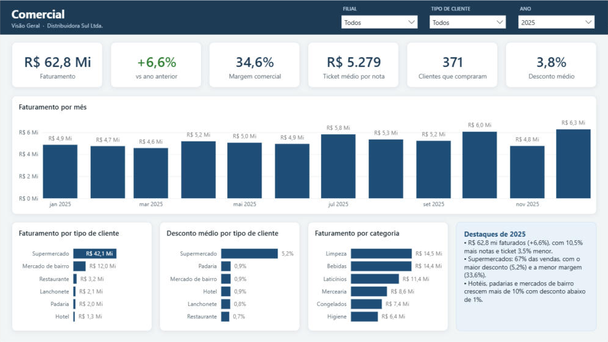
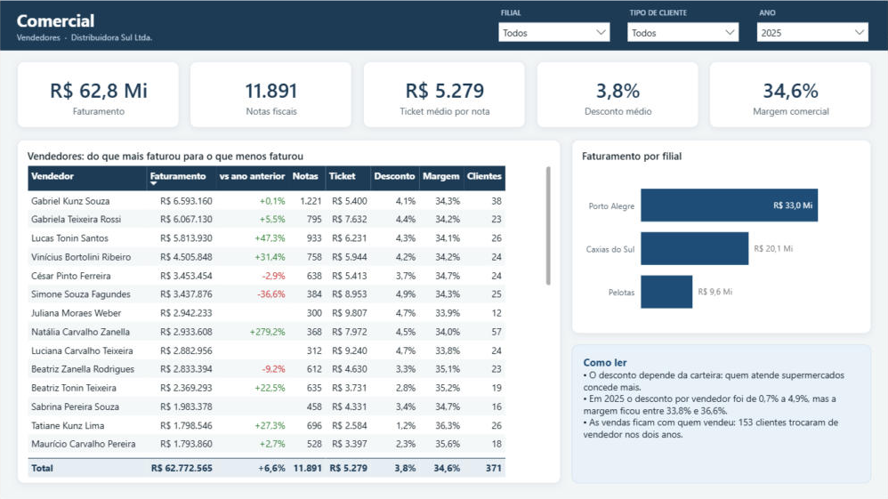
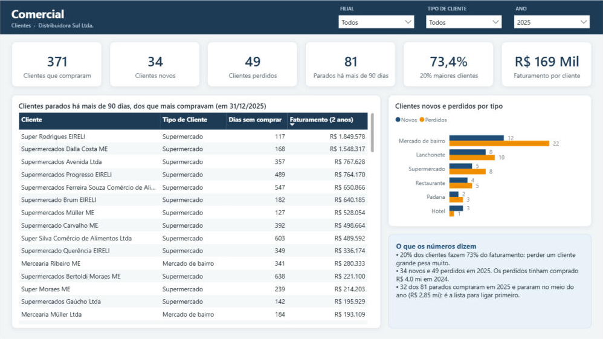

# Painel Comercial: roteiro

Projeto 5 do portfólio, sobre o mesmo modelo estrela da Distribuidora Sul. O modelo semântico (6 tabelas, 5 relacionamentos e 25 medidas DAX) está em [`powerbi/Comercial.SemanticModel`](../powerbi/Comercial.SemanticModel/definition/tables/Medidas.tmdl), em formato PBIP/TMDL, com a mesma identidade visual dos outros painéis. Os indicadores também são calculados em SQL, por outro caminho, na view [`dw.vw_conferencia_comercial`](../sql/10_comercial.sql), e o painel tem uma [versão web interativa](https://lucasgama.vercel.app/comercial.html), alimentada por [`python/exportar_web.py`](../python/exportar_web.py).

## Perguntas que o painel responde

1. Quanto vendemos, com que margem e com que desconto?
2. Para quem vendemos: que tipo de cliente, que filial, que categoria?
3. Como cada vendedor vende: faturamento, ticket, desconto e margem?
4. A carteira de clientes está crescendo ou encolhendo? Quem parou de comprar?

## Páginas do Power BI

Filtros de **Filial**, **Tipo de cliente** e **Ano** (abre em 2025) no cabeçalho.

| Página | Conteúdo |
|---|---|
| **Visão Geral** | Faturamento, variação contra o ano anterior (verde ou vermelho), margem comercial, ticket médio, clientes que compraram e desconto médio · faturamento por mês · faturamento e desconto médio por tipo de cliente · faturamento por categoria · destaques de 2025 |
| **Vendedores** | Faturamento, notas, ticket, desconto e margem · tabela com faturamento, variação, notas, ticket, desconto, margem e clientes de cada vendedor · faturamento por filial |
| **Clientes** | Clientes que compraram, novos, perdidos, parados há mais de 90 dias, fatia dos 20% maiores e faturamento por cliente · clientes parados que mais compravam, com os dias sem comprar · novos e perdidos por tipo de cliente |

A [versão web](https://lucasgama.vercel.app/comercial.html) tem as mesmas três páginas, com clique num mês, num tipo de cliente ou numa filial para filtrar, a curva de concentração e a distribuição de clientes pelo tempo sem comprar.

## Modelo

| Tabela | Grão | Uso |
|---|---|---|
| `Venda` | item de nota fiscal | Faturamento, desconto, custo e devoluções. A coluna `Nota` (filial + número) identifica a nota, porque a numeração é por filial |
| `Cliente` | cliente | Tipo, cidade, condição de pagamento e situação |
| `Vendedor` | vendedor | Vendedores externos e supervisores, com a situação atual |
| `Produto`, `Filial`, `Calendário` | | Dimensões compartilhadas com os outros painéis |

As medidas de clientes usam a própria tabela de vendas: **novos** e **perdidos** comparam `VALUES(Venda[cliente_key])` do período com o do mesmo período do ano anterior (`SAMEPERIODLASTYEAR` + `EXCEPT`); a **concentração** soma o faturamento dos primeiros `ROUNDUP(n / 5)` clientes do ranking (`TOPN`), como o `NTILE(5)` do SQL; os **parados** comparam a última venda de cada cliente com a data de corte, ignorando o filtro de ano.

## Definições

| Indicador | Definição |
|---|---|
| Faturamento | Vendas já com desconto, antes das devoluções e dos impostos. É a receita bruta da DRE (conta 3.01) |
| Desconto médio | Desconto ÷ valor de tabela das vendas |
| Margem comercial | (Venda líquida − custo das vendas) ÷ venda líquida, antes dos impostos. Por isso é maior que a margem bruta da DRE, que desconta os impostos sobre vendas |
| Notas fiscais | Notas de venda distintas por filial (a numeração é por série, e a série é a filial) |
| Ticket médio | Faturamento ÷ notas fiscais |
| Clientes novos / perdidos | Novo: comprou no período e não no mesmo período do ano anterior. Perdido: o contrário |
| Concentração | Fatia do faturamento que vem do primeiro quinto do ranking de clientes (`NTILE(5)`) |
| Parados | Clientes que já compraram e estão há mais de 90 dias sem comprar em 31/12/2025 |

## Decisões de modelagem

- **Faturamento igual à DRE.** O painel usa a mesma base da receita bruta do painel Financeiro, então os dois painéis nunca mostram números diferentes para a mesma coisa. Custo das vendas e devoluções também batem com o CMV e a conta 3.02.
- **Mês × cliente × vendedor.** A exportação para a web fica nesse grão (7,4 mil linhas). Com ele dá para filtrar por filial, tipo de cliente e vendedor e ainda contar clientes distintos em qualquer período, o que não seria possível com totais já somados.
- **Cliente com mais de um vendedor.** 153 clientes trocaram de vendedor nos dois anos, por causa da rotatividade da equipe comercial. As vendas ficam com quem vendeu, não com o vendedor atual da carteira.
- **Valor de tabela não exportado.** É faturamento + desconto, então sai do arquivo e é recalculado no navegador, o que deixa o JSON menor.

## Histórias nos dados

- O faturamento cresceu **6,6%** em 2025 (R$ 62,8 mi), com mais notas (**+10,5%**) e ticket menor (**−3,5%**, R$ 5.279 por nota). A margem comercial ficou em **34,6%** (+0,3 p.p.) e o desconto médio, estável em **3,8%**.
- **Supermercados são 67% do faturamento**, com o maior desconto (**5,2%**) e a menor margem (**33,6%**). Os pequenos crescem mais (hotéis +16,9%, padarias +10,3%, mercados de bairro +10,1%) com desconto abaixo de 1% e margem perto de 36,5%.
- **20% dos clientes fazem 73% do faturamento.** Perder um cliente grande pesa muito.
- A carteira **encolheu**: 371 clientes compraram em 2025, contra 386 em 2024. Foram **34 novos e 49 perdidos**, e os perdidos tinham comprado **R$ 4,0 mi** em 2024 (8 deles são supermercados).
- **81 clientes** estão há mais de 90 dias sem comprar. **32 deles ainda compraram em 2025** (R$ 2,85 mi) e pararam no meio do ano: é a lista para a equipe comercial ligar primeiro. O maior é o Super Rodrigues EIRELI, que comprou R$ 1,85 mi nos dois anos e está sem comprar desde 05/09/2025.
- O desconto por vendedor vai de **0,7% a 4,9%**, mas a margem fica entre 33,8% e 36,6%: a diferença vem da carteira (quem atende supermercados dá mais desconto), não de um vendedor "dando desconto demais".

## Números de conferência

Calculados em SQL por outro caminho (`dw.vw_conferencia_comercial`, script [`sql/10_comercial.sql`](../sql/10_comercial.sql)). As 25 medidas foram executadas no motor do Power BI Desktop e os 25 indicadores abaixo bateram, sem divergência. O `exportar_web.py` faz a mesma conferência com o JSON da versão web antes de gravar o arquivo.

| Indicador | 2024 | 2025 |
|---|---:|---:|
| Faturamento | R$ 58.906.528 | R$ 62.772.565 |
| Descontos concedidos | R$ 2.353.034 | R$ 2.505.856 |
| Desconto médio % | 3,8% | 3,8% |
| Devoluções | R$ 228.269 | R$ 256.194 |
| Venda líquida | R$ 58.678.259 | R$ 62.516.372 |
| Custo das vendas | R$ 38.527.971 | R$ 40.890.111 |
| Margem comercial % | 34,3% | 34,6% |
| Notas fiscais | 10.765 | 11.891 |
| Ticket médio | R$ 5.472 | R$ 5.279 |
| Clientes que compraram | 386 | 371 |
| Clientes novos | | 34 |
| Clientes perdidos | | 49 |
| Faturamento dos 20% maiores % | 74,8% | 73,4% |

| Posição em 31/12/2025 | |
|---|---:|
| Clientes sem compra há mais de 90 dias | 81 |

## Como abrir

1. Rode `python python/carregar_sql.py` para ter o banco `DistribuidoraSul` no SQL Server Express.
2. Abra `powerbi/Comercial.pbip` no Power BI Desktop e clique em **Atualizar**.
