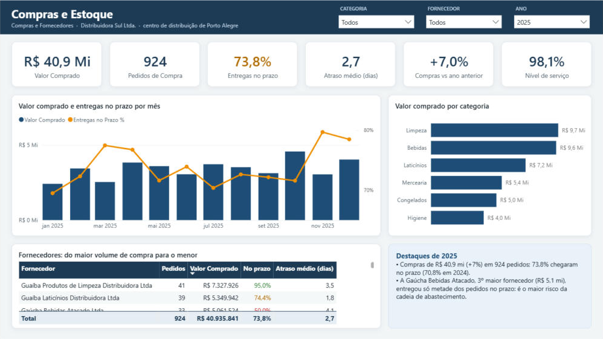
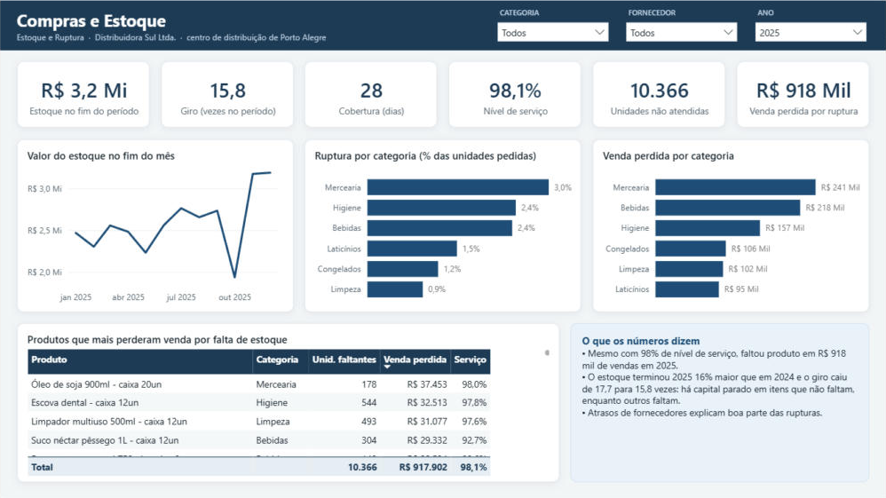
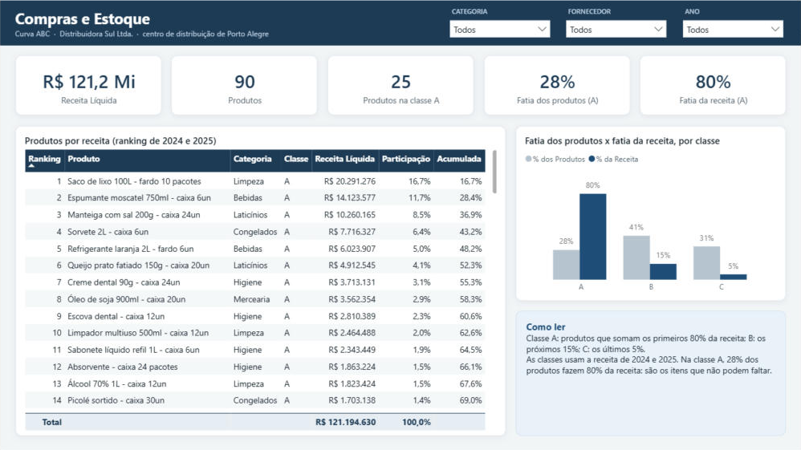

# Painel Compras e Estoque: roteiro

Projeto 3 do portfólio, sobre o mesmo modelo estrela da Distribuidora Sul. O modelo semântico (6 tabelas, 7 relacionamentos e 29 medidas DAX) está em [`powerbi/ComprasEstoque.SemanticModel`](../powerbi/ComprasEstoque.SemanticModel/definition/tables/Medidas.tmdl), com a mesma identidade visual dos painéis [Financeiro](painel_financeiro.md) e [People Analytics](painel_people_analytics.md).

## Perguntas que o painel responde

1. Quanto compramos, de quem, e os fornecedores entregam no prazo?
2. O estoque está saudável? Quanto vale, quanto gira e quantos dias cobre?
3. Quanto deixamos de vender por falta de produto, e em quais itens?
4. Quais produtos fazem a receita (curva ABC)?

## Páginas

Filtros de **Categoria**, **Fornecedor** e **Ano** no cabeçalho (o ano abre em 2025 nas duas primeiras páginas e em "Todos" na curva ABC).

| Página | Conteúdo |
|---|---|
| **Compras e Fornecedores** | Valor comprado, pedidos, entregas no prazo (verde/âmbar/vermelho), atraso médio, compras vs ano anterior, nível de serviço · compras e pontualidade por mês · compras por categoria · ranking de fornecedores com pontualidade colorida |
| **Estoque e Ruptura** | Estoque no fim do período, giro, cobertura em dias, nível de serviço, unidades não atendidas, venda perdida · estoque no fim de cada mês · ruptura e venda perdida por categoria · produtos que mais perderam venda |
| **Curva ABC** | Receita, produtos, produtos na classe A e fatias de produtos e receita · ranking de produtos com participação acumulada · fatia dos produtos × fatia da receita por classe |

## Modelo

| Tabela | Grão | Uso |
|---|---|---|
| `Compra` | item de pedido de compra | Valor comprado e pontualidade (relação ativa pela data do pedido; entrega real inativa) |
| `Movimento de Estoque` | movimento | Saldo inicial, entradas, saídas e devoluções a custo; a soma acumulada dá a posição |
| `Venda` | item de nota fiscal | Quantidade pedida × faturada (nível de serviço) e receita (curva ABC) |
| `Produto` | produto | Categoria, fornecedor principal e classe ABC (juntada no Power Query com `dw.vw_curva_abc_produto`) |
| `Calendário` | dia | Compartilhada com os outros painéis |

## Decisões de modelagem

- **Pontualidade por pedido, não por item.** Todos os itens de um pedido chegam juntos, então a medida monta a lista de pedidos (`ADDCOLUMNS(VALUES(...))`) e conta quantos chegaram no prazo. Contar por item daria mais peso a pedidos grandes.
- **Estoque é saldo acumulado.** A posição numa data é a soma de todos os movimentos até ela, limitada à data de corte para a linha não seguir reta pelos meses sem dados. Estoque médio é a média das posições de fim de mês.
- **Giro e cobertura com a mesma base.** Giro = CMV ÷ estoque médio; cobertura = estoque final ÷ CMV médio por dia do período.
- **Fornecedor pelo produto.** Cada produto tem um fornecedor principal, então o filtro de fornecedor vem da tabela `Produto` e filtra compras, estoque e vendas ao mesmo tempo, sem uma dimensão de fornecedor separada (que criaria dois caminhos de filtro).
- **Curva ABC fixa.** As classes são calculadas uma vez, sobre a receita de 2024 e 2025, para o produto não "mudar de classe" a cada filtro. A página abre sem filtro de ano para a receita bater com as classes.

## Histórias nos dados

- Mesmo com **98,1% de nível de serviço**, faltou produto em **R$ 918 mil de vendas** em 2025 (cerca de 1,5% da receita bruta). A Mercearia tem a maior ruptura (3,0% das unidades pedidas).
- A **Gaúcha Bebidas Atacado**, 3º maior fornecedor (R$ 5,1 mi em 2025), entregou **só metade dos pedidos no prazo**.
- A pontualidade geral melhorou de **70,8% para 73,8%**, com atraso médio de 2,7 dias quando atrasa.
- O estoque terminou 2025 **16% maior** (R$ 2,7 → 3,2 mi) e o giro caiu de **17,7 para 15,8** vezes: há capital parado em itens que não faltam, enquanto outros faltam. A cobertura é de **28 dias**.
- **25 produtos (28%) fazem 80% da receita** (classe A): são os itens que não podem faltar.

## Números de conferência

Calculados em SQL por outro caminho (`dw.vw_conferencia_compras`, script [`sql/09_compras_estoque.sql`](../sql/09_compras_estoque.sql)). As 29 medidas foram executadas no motor do Power BI Desktop e os 22 indicadores abaixo bateram, sem divergência.

| Indicador | 2024 | 2025 |
|---|---:|---:|
| Valor comprado | R$ 38.274.580 | R$ 40.935.841 |
| Pedidos de compra | 918 | 924 |
| Entregas no prazo | 70,8% | 73,8% |
| Atraso médio quando atrasa (dias) | 2,9 | 2,7 |
| Nível de serviço | 97,9% | 98,1% |
| Unidades não atendidas | 11.784 | 10.366 |
| Venda perdida por ruptura | R$ 920.645 | R$ 917.902 |
| Estoque no fim do ano | R$ 2.744.913 | R$ 3.188.982 |
| Estoque médio | R$ 2.179.744 | R$ 2.587.720 |
| CMV das vendas | R$ 38.527.971 | R$ 40.890.111 |
| Giro de estoque | 17,7 | 15,8 |

## Como abrir

1. Rode `python python/carregar_sql.py` para ter o banco `DistribuidoraSul` no SQL Server Express.
2. Abra `powerbi/ComprasEstoque.pbip` no Power BI Desktop e clique em **Atualizar**.
