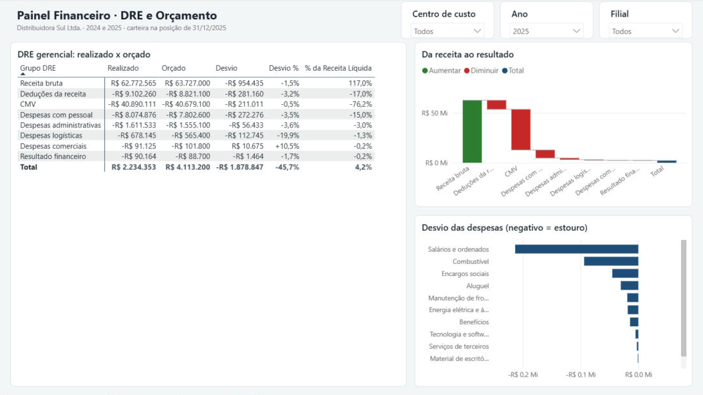
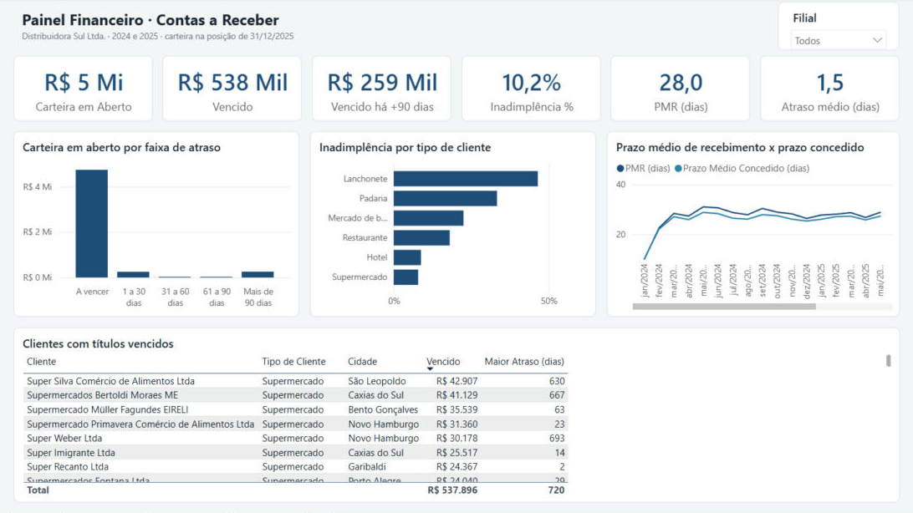
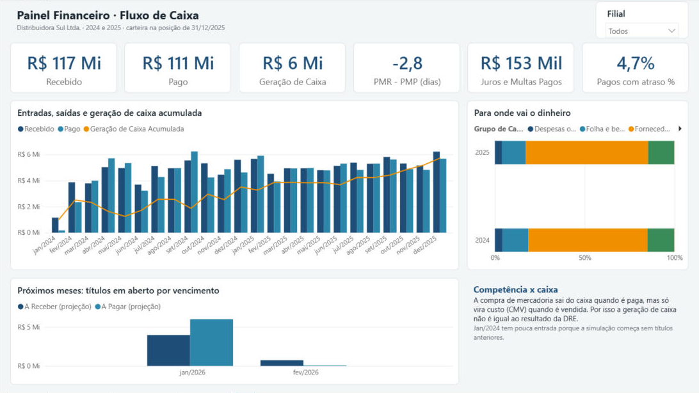

# Painel Financeiro: roteiro

Projeto 1 do portfólio, construído sobre o modelo estrela da Distribuidora Sul. O modelo semântico (tabelas, relacionamentos e 55 medidas DAX) está em [`powerbi/Financeiro.SemanticModel`](../powerbi/Financeiro.SemanticModel/definition/tables/Medidas.tmdl), em formato PBIP/TMDL (texto, versionado no Git).

## Perguntas que o painel responde

1. A empresa está crescendo com lucro? (receita, margens e resultado contra o ano anterior)
2. Onde o realizado fugiu do orçamento, e por quê?
3. Quem está devendo, quanto, há quanto tempo, e que tipo de cliente atrasa mais?
4. O caixa acompanha o resultado? A empresa recebe antes ou depois de pagar os fornecedores?

## Páginas

Tela de 1280 × 720 com o tema [`powerbi/tema_distribuidora_sul.json`](../powerbi/tema_distribuidora_sul.json). Os filtros de cada visual ficam dentro das medidas (por exemplo, `Desvio das Despesas` e `A Receber (projeção)`), então nenhum visual tem filtro escondido.

### 1. Resumo

| Visual | Campos e medidas |
|---|---|
| Filtros | Ano (abre em **2025**) e Filial |
| 6 cartões | Receita Líquida, Margem Bruta %, Resultado Líquido, Margem Líquida %, Geração de Caixa, Inadimplência % |
| Colunas + linha | Eixo: Calendário[Mês/Ano] · Colunas: Receita Líquida · Linha: Margem Líquida % |
| 4 cartões de comparação | Receita Líquida vs Ano Anterior %, Margem Líquida vs Ano Anterior (p.p.), Atingimento da Receita %, Desvio do Resultado |
| Colunas agrupadas | Eixo: Calendário[Mês/Ano] · Valores: Resultado Líquido e Resultado Orçado |
| Caixa de texto | Destaques de 2025 (ver "Histórias nos dados") |

### 2. DRE e Orçamento

| Visual | Campos e medidas |
|---|---|
| Filtros | Centro de custo, Ano (abre em **2025**) e Filial |
| Matriz (DRE) | Linhas: Conta[Grupo DRE] → Conta[Conta] (clique no + para abrir as contas) · Valores: Realizado, Orçado, Desvio, Desvio %, % da Receita Líquida |
| Cascata | Categoria: Conta[Grupo DRE] · Valor: Realizado (da receita bruta até o resultado) |
| Barras horizontais | Eixo: Conta[Conta] · Valor: Desvio das Despesas, do maior estouro para o menor |

O orçamento não é aberto por filial: com uma filial selecionada, Orçado e Desvio ficam em branco de propósito.

### 3. Contas a Receber

| Visual | Campos e medidas |
|---|---|
| Filtros | Filial (sem filtro de ano: a carteira é uma fotografia em 31/12/2025) |
| 6 cartões | Carteira em Aberto, Vencido, Vencido há Mais de 90 Dias, Inadimplência %, PMR (dias), Atraso Médio no Recebimento (dias) |
| Colunas | Eixo: Contas a Receber[Faixa de Aging] · Valor: Carteira em Aberto |
| Barras | Eixo: Cliente[Tipo de Cliente] · Valor: Inadimplência % |
| Linhas | Eixo: Calendário[Mês/Ano] · Valores: PMR (dias) e Prazo Médio Concedido (dias) |
| Tabela | Cliente, Tipo de Cliente, Cidade, Vencido, Maior Atraso (dias), do maior valor vencido para o menor |

### 4. Fluxo de Caixa

| Visual | Campos e medidas |
|---|---|
| Filtros | Filial (sem filtro de ano, para mostrar a série inteira e a projeção de 2026) |
| 6 cartões | Recebido, Pago, Geração de Caixa, PMR - PMP (dias), Juros e Multas Pagos, Pagamentos em Atraso % |
| Colunas agrupadas + linha | Eixo: Calendário[Mês/Ano] · Colunas: Recebido e Pago · Linha: Geração de Caixa Acumulada (para em dez/2025) |
| Barras 100% | Eixo: Calendário[Ano] · Legenda: Conta[Grupo de Caixa] · Valor: Pago |
| Colunas (projeção) | Eixo: Calendário[Mês/Ano] · Valores: A Receber (projeção) e A Pagar (projeção) |
| Caixa de texto | Competência × caixa |

## Testes

As 55 medidas foram executadas no motor do Power BI Desktop. Os 42 indicadores da view de conferência bateram com o SQL, sem divergência. Também conferimos: orçado vazio com filtro de filial, soma da DRE igual ao resultado e inadimplência que não muda com o filtro de ano.

## Decisões de modelagem (bons pontos para entrevista)

- **Competência × caixa.** A DRE usa competência (`fato_dre`); o fluxo de caixa usa a data de pagamento. A compra de mercadoria (conta 1.05) aparece no caixa, mas não na DRE: entra no resultado só quando a mercadoria é vendida, como CMV.
- **Várias datas na mesma fato.** Contas a receber e a pagar se ligam ao calendário pelo vencimento (relação ativa). Emissão e pagamento são relações inativas, ativadas com `USERELATIONSHIP` nas medidas de caixa e de prazo médio.
- **Sinal da DRE na dimensão.** `Conta[Sinal]` (+1 receita, −1 custos e despesas) faz a soma da matriz dar o resultado, e o mesmo sinal no orçamento deixa o Desvio com uma leitura só: negativo = pior que o orçado, tanto para receita quanto para despesa.
- **Prazos ponderados por valor.** PMR e PMP são médias ponderadas pelo valor do título: um título de R$ 50 mil pesa mais que um de R$ 500.
- **Ordenação no Power Query.** A ordem das faixas de aging é calculada no Power Query, não em DAX: uma coluna calculada derivada da coluna que ela ordena gera dependência circular.

## Histórias nos dados

- A receita líquida cresceu **6,5%** em 2025, mas ficou abaixo do orçado nos dois anos (**95,8%** e **98,5%** de atingimento). Em 2024 pesa a queda de maio na matriz (enchentes em Porto Alegre).
- A margem líquida subiu de **3,5% para 4,2%**, mas o resultado ficou **R$ 1,9 milhão abaixo do orçado** em 2025: orçamento de receita otimista e estouro de frota (manutenção **+31%**, combustível **+19%**).
- **10,2%** da carteira está vencida e R$ 259 mil passam de 90 dias. Supermercados concentram o valor vencido (R$ 351 mil), mas a **taxa** de inadimplência é muito maior nos pequenos: lanchonetes **46,5%**, padarias **33,3%**, mercados de bairro **22,5%**.
- Capital de giro favorável: a empresa recebe em **28 dias** e paga fornecedores em **31**. Mas os clientes pagam, em média, **cerca de 1,5 dia** depois do combinado.

## Números de conferência

Calculados em SQL por outro caminho (`dw.vw_conferencia_financeiro`, script [`sql/07_conferencia_financeiro.sql`](../sql/07_conferencia_financeiro.sql)). Os cartões do painel, sem filtro de filial, têm que bater com eles.

| Indicador | 2024 | 2025 |
|---|---:|---:|
| Receita Bruta | R$ 58.906.528 | R$ 62.772.565 |
| Receita Líquida | R$ 50.375.285 | R$ 53.670.306 |
| CMV | R$ 38.527.971 | R$ 40.890.111 |
| Lucro Bruto | R$ 11.847.315 | R$ 12.780.195 |
| Margem Bruta % | 23,5% | 23,8% |
| Despesas Operacionais | R$ 10.018.937 | R$ 10.455.678 |
| Resultado Líquido | R$ 1.749.848 | R$ 2.234.353 |
| Margem Líquida % | 3,5% | 4,2% |
| Receita Orçada | R$ 61.510.600 | R$ 63.727.000 |
| Atingimento da Receita % | 95,8% | 98,5% |
| Resultado Orçado | R$ 3.299.000 | R$ 4.113.200 |
| Desvio do Resultado | −R$ 1.549.152 | −R$ 1.878.847 |
| Recebido | R$ 53.441.518 | R$ 63.136.476 |
| Pago | R$ 49.937.422 | R$ 60.925.343 |
| Geração de Caixa | R$ 3.504.096 | R$ 2.211.133 |
| PMR (dias) | 27,9 | 28,0 |
| Prazo Médio Concedido (dias) | 26,3 | 26,6 |
| PMP (dias) | 30,9 | 30,7 |

| Posição em 31/12/2025 | |
|---|---:|
| Carteira em Aberto | R$ 5.277.582 |
| Vencido | R$ 537.896 |
| Vencido há Mais de 90 Dias | R$ 258.573 |
| Inadimplência % | 10,2% |
| Clientes Inadimplentes | 78 |
| A Pagar em Aberto | R$ 5.981.087 |

> A simulação começa em 01/01/2024 sem títulos anteriores a receber ou a pagar. Por isso jan/2024 tem pouca entrada de caixa (R$ 1,2 milhão) e 2024 tem geração de caixa maior que 2025. Vale mencionar ao apresentar o painel.

## Como abrir

1. Rode `python python/carregar_sql.py` para ter o banco `DistribuidoraSul` no SQL Server Express.
2. Abra `powerbi/Financeiro.pbip` no Power BI Desktop. Os parâmetros **Servidor** e **Banco** ficam em Transformar dados → Gerenciar parâmetros.
3. Clique em **Atualizar** para importar os dados. O projeto é salvo sem dados (o cache fica fora do Git), então a primeira abertura mostra os visuais em branco até atualizar.
