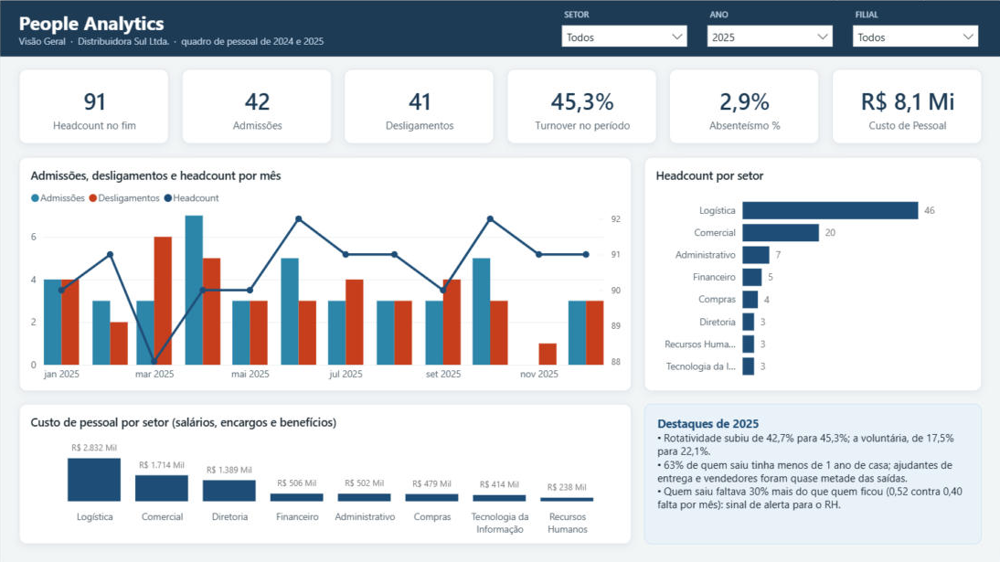
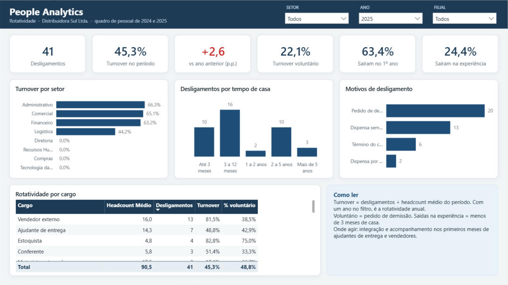
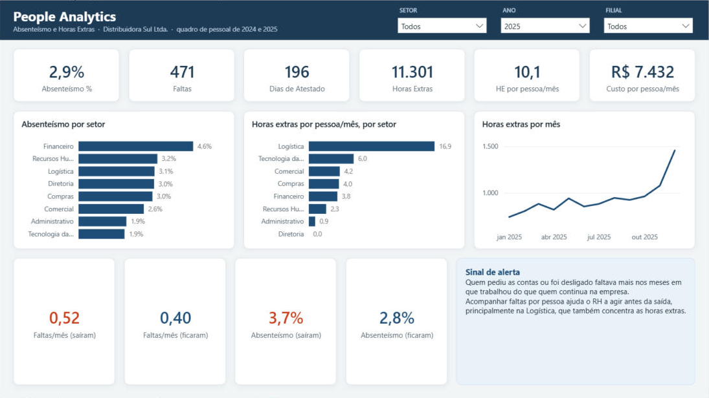

# Painel People Analytics: roteiro

Projeto 2 do portfólio, sobre o mesmo modelo estrela da Distribuidora Sul. O modelo semântico (8 tabelas, 11 relacionamentos e 34 medidas DAX) está em [`powerbi/PeopleAnalytics.SemanticModel`](../powerbi/PeopleAnalytics.SemanticModel/definition/tables/Medidas.tmdl), no mesmo formato PBIP/TMDL e com a mesma identidade visual do [painel Financeiro](painel_financeiro.md).

## Perguntas que o painel responde

1. Quantas pessoas a empresa tem, onde estão e quanto custam?
2. Quem sai, de onde, por quê e com quanto tempo de casa?
3. Onde estão as faltas e as horas extras?
4. Quem sai dá sinais antes de sair?

## Páginas

Todas as páginas têm filtros de **Setor**, **Ano** (abre em 2025) e **Filial** no cabeçalho.

| Página | Conteúdo |
|---|---|
| **Visão Geral** | Headcount no fim do período, admissões, desligamentos, turnover, absenteísmo e custo de pessoal · admissões × desligamentos × headcount por mês · headcount e custo de pessoal por setor · destaques de 2025 |
| **Rotatividade** | Turnover, variação contra o ano anterior (vermelho quando sobe), turnover voluntário, % de saídas no 1º ano e na experiência · turnover por setor · desligamentos por tempo de casa e por motivo · tabela por cargo |
| **Absenteísmo e Horas Extras** | Absenteísmo, faltas, atestados, horas extras e custo médio por pessoa · absenteísmo e horas extras por setor · horas extras por mês · faltas e absenteísmo de quem saiu × quem ficou |

## Modelo

| Tabela | Grão | Uso |
|---|---|---|
| `Quadro Mensal` | funcionário × mês | Headcount, admissões, desligamentos (indicadores 0/1, convertidos no Power Query) |
| `Ponto` | funcionário × mês | Dias previstos, faltas, atestados, horas extras |
| `Custo de Pessoal` | mês × setor × filial × tipo | Salários, encargos e benefícios (view `dw.vw_custo_pessoal`) |
| `Funcionário` | funcionário | Cargo, faixa etária, tempo de casa, motivo e tipo de desligamento, situação |
| `Calendário`, `Centro de Custo`, `Filial` | | Dimensões compartilhadas com o painel Financeiro |

## Decisões de modelagem

- **Headcount é um saldo, não uma soma.** A medida pega o último mês do período (`MAX` da competência) e soma só os ativos daquele mês. Somar o headcount de vários meses não faz sentido.
- **Turnover sobre o headcount médio.** Desligamentos ÷ média de (início + fim) de cada mês, a definição mais usada em RH. Com um ano no filtro, é a rotatividade anual.
- **Funcionário sem relacionamento com setor e filial.** As fatos (quadro, ponto e custo) já trazem setor e filial do mês. Ligar o funcionário a elas também criaria dois caminhos de filtro (ambiguidade) e misturaria o setor atual com o setor da época.
- **Sinal de alerta com contexto de filtro.** "Faltas por mês de quem saiu × quem ficou" filtra `'Funcionário'[Situação]` e compara a média por mês trabalhado, então respeita setor, filial e ano.
- **Nome de tabela com acento precisa de aspas em DAX.** `'Funcionário'[Cargo]`, como `'Calendário'[Data]`. Sem as aspas a medida quebra com erro de sintaxe (aconteceu e foi pego no teste automático).

## Histórias nos dados

- A rotatividade subiu de **42,7% para 45,3%**, e a voluntária de **17,5% para 22,1%**: mais gente pedindo para sair.
- **62,5%** das saídas de 2024 e 2025 aconteceram no **1º ano** de casa (63% em 2025), e 21 de 80 ainda na experiência.
- **Ajudantes de entrega e vendedores** somam 42 das 80 saídas dos dois anos.
- **Quem saiu faltava mais** do que quem ficou: 24% a mais nos dois anos e **30% a mais em 2025** (0,52 contra 0,40 falta por mês trabalhado).
- A **Logística** faz **16,9 h extras por pessoa por mês**, contra cerca de 4 h nos outros setores, e concentra 35% do custo de pessoal.
- Custo de pessoal de **R$ 8,1 mi** em 2025 (+3,5%), cerca de **R$ 7,4 mil por pessoa por mês** com encargos e benefícios.

## Números de conferência

Calculados em SQL por outro caminho (`dw.vw_conferencia_rh`, script [`sql/08_people_analytics.sql`](../sql/08_people_analytics.sql)). As 34 medidas foram executadas no motor do Power BI Desktop e os 20 indicadores abaixo bateram, sem divergência.

| Indicador | 2024 | 2025 |
|---|---:|---:|
| Headcount (dezembro) | 90 | 91 |
| Headcount médio | 91,4 | 90,5 |
| Admissões | 35 | 42 |
| Desligamentos | 39 | 41 |
| Turnover % | 42,7% | 45,3% |
| Turnover voluntário % | 17,5% | 22,1% |
| Desligamentos na experiência | 11 | 10 |
| Absenteísmo % | 3,2% | 2,9% |
| Horas extras | 11.355 | 11.301 |
| Custo de pessoal | R$ 7.799.046 | R$ 8.074.876 |

## Como abrir

1. Rode `python python/carregar_sql.py` para ter o banco `DistribuidoraSul` no SQL Server Express.
2. Abra `powerbi/PeopleAnalytics.pbip` no Power BI Desktop e clique em **Atualizar**.
